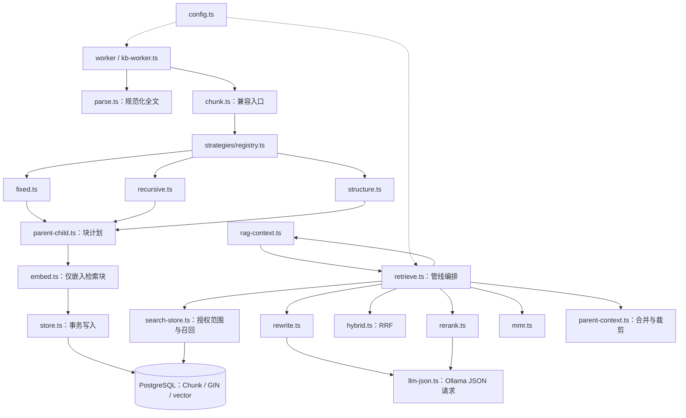
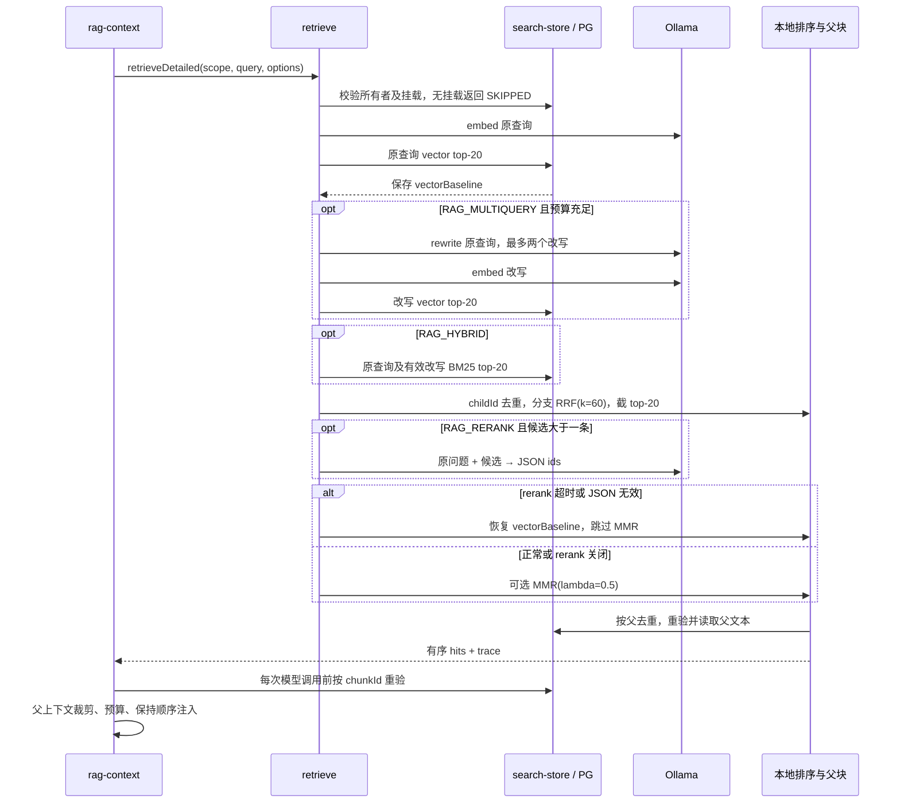

# M9 RAG 质量增强代码架构

任务：T-20260921-ad6fffa2。本文仅定义后续实现契约，不包含实现代码、已通过测试或验收结论。

## 1. 基线与范围

依据：[现有架构](../rag-arch.md)、[M9 决策](00-grill-report.md)，并读取 `packages/rag/src/{chunk,embed,store,retrieve,parse}.ts`、`index.ts`、数据库 schema 与 `apps/web/src/lib/rag-context.ts`。

实际代码：`chunk(parts,512,50)` 按规范化文本的 Unicode code point 切割；`parse` 返回平面 `Part[]`，PDF 由 worker 注入解析器；`embed` 使用 bge-m3、1024 维、每批 16、串行；`store` 在租约保护事务中替换所有块；`retrieve` 按余弦距离取 5 条。Chunk.embedding 当前非空，尚无父子关系或全文字段。保留所有权、挂载关系、READY、嵌入模型过滤及租约/attempt 规则。

本设计覆盖策略切割、父子块、BM25+向量 RRF、LLM rerank、多查询和 MMR。维持现有 PostgreSQL/pgvector 与 Ollama，不引入 ES、云向量库、OCR、ANN 或协作编排改造。重切割入口及实验/UI 只定义接入边界，后续任务实施。

特别注意：现有 `rag-context.ts` 的 `topHits` 会再次按 distance 排序，`revalidateContext` 会按 ordinal 重新读全文；原样保留会覆盖融合顺序及裁剪结果。接入修改是本设计的必要组成部分。

## 2. 模块图

## 3. 数据与切割契约

### 3.1 统一类型（签名为设计声明，无函数实现）

| 类型 | 约定 |
|---|---|
| `StrategyName` | `'fixed' \| 'recursive' \| 'structure'`；未知策略拒绝入队，不静默换策略 |
| `ChunkConfig` | `{childMin, childTarget, childMax, childOverlap, parentMax, fixedSize, fixedOverlap, parentChild}`；数值均为 code point 数，不宣称等同 tokenizer tokens |
| `ChunkInput` | `{parts: Part[], mime: string}`；全文为 normalize 后以换行拼接的文本 |
| `ChunkStrategy` | `readonly name: StrategyName; split(input: ChunkInput, config: Readonly<ChunkConfig>): ChunkPlan` |
| `PlannedChunk` | `{key, parentKey: string\|null, kind: 'PARENT'\|'CHILD'\|'STANDALONE', ordinal, start, end, text, headingPath: string[]}` |
| `ChunkPlan` | `{chunks: PlannedChunk[], strategy: StrategyName, config: ChunkConfig}`；key 为计划内唯一标识，入库统一映射 UUID |
| `SearchScope` | 服务端构建的 `{userId, conversationId, model}`；每个数据库操作仍核验权限，不能把对象当作授权证明 |
| `Candidate` | `{chunkId, parentId, documentId, ordinal, name, text, headingPath, embedding, distance, score, sources}`；distance 始终为**原查询**余弦距离，embedding 仅管线内部使用 |
| `RankedList` | `{source, queryIndex, items: Candidate[]}`；每个列表先按 chunkId 唯一化 |
| `SearchOptions` | `{signal: AbortSignal, deadlineAt: number, config: RetrievalConfig}`；deadlineAt 为统一单调时钟截止时间 |
| `RagHitV2` | 兼容旧 Hit 字段，增加 `{chunkId, parentId, rank, matchedChildIds, headingPath, excerptStart, excerptEnd, sources}`；引用 ordinal 属于实际返回的父块/独立块/子块，不能把父文本挂在任意子 ordinal 上 |
| `RetrievalResult` | `{hits: RagHitV2[], trace: RetrievalTrace}`；trace 记录配置版本、分支耗时、候选数及降级原因，不记录完整提示词/文档 |

### 3.2 策略注册表与参数

启动时注册三个无状态实现；重复名称报错，注册完成后冻结。worker 读取 `Document.chunkStrategy`，通过 registry 分派，策略不能访问数据库或模型。旧 `chunk(parts,size,overlap)` 保留固定窗兼容入口，M9 worker 改用 `planChunks`。

- **fixed**：固定窗；默认 512/50 保留对照。启用父子模式时在父区间内切窗，可配置为 256/32。实验基线使用 fixed + parentChild=false + 512/50。
- **recursive**：按段落、换行、句末、空白、code point 逐级回退；尽量接近 256，通常 128–384。超过 384 必须继续拆；尾块或不可跨越结构边界的短段允许小于 128，标注原因，不填充文本。
- **structure**：识别 Markdown ATX/Setext 标题及层级，维护 headingPath；围栏代码内的 `#` 不当标题。段落、列表、代码围栏作为优先边界，超长单元递归拆分；TXT/PDF 无结构时明确回退 recursive，并记录 effectiveStrategy。

父块上限 1500，沿连续原文区间组装，不跨文档；过长章节先拆父区间。子块仅在一个父区间内生成，重叠不得越过父边界。`start/end` 为规范化全文的半开区间，text 必须等于该区间原文；headingPath 为元数据，不重复拼入 text。配置校验：0 < min ≤ target ≤ max ≤ parentMax，0 ≤ overlap < min，fixedOverlap < fixedSize；父子 fixed 模式还要求 fixedSize ≤ parentMax。参数随 Document 持久化，重试不受环境配置变更影响。

### 3.3 Schema 与增量兼容

| 字段/索引 | 设计 |
|---|---|
| `Document.chunkStrategy String?` | 新文档由应用写入默认 structure；旧 NULL 按 fixed 解释，不因部署自动重切 |
| `Document.chunkConfig Json?` | 保存解析后的参数与配置版本；旧 NULL 使用 legacy 512/50、无父子配置 |
| `Chunk.parentId String?` | 自引用 FK，索引 `(documentId,parentId)`；父块 parentId=NULL。使用 `(documentId,parentId)`→`(documentId,id)` 复合约束及对应唯一键防跨文档引用 |
| `Chunk.kind String?` | NULL 为旧 STANDALONE；新增 PARENT/CHILD/STANDALONE。不能仅以 parentId=NULL 判断是否可召回 |
| `Chunk.headingPath Json?` | 有序标题路径，缺省读取为空数组 |
| `Chunk.embedding vector(1024)?` | 放宽为空：PARENT 无向量，CHILD/STANDALONE 必须有合法向量；通过约束和 store 双重校验 |
| `Chunk.searchText Text?` | 应用写入归一化词项序列，生成列的输入；旧行未回填时 hybrid 不可视为完整覆盖 |
| `Chunk.searchVector tsvector` | `GENERATED ALWAYS AS (to_tsvector('simple'::regconfig, coalesce(searchText,''))) STORED`；建 GIN。显式固定配置，不依赖会话默认配置；Prisma 用 Unsupported，raw SQL 参数化访问 |
| `Chunk.lexicalStats Json?` | 同一分词器产生的词频及总词数，供真实 BM25；不从有位置截断风险的 tsvector 反推词频 |

ordinal 仍在整个文档中唯一：先按原文顺序编号所有检索块，再给父块编号；引用可定位父行。chunkCount 只计 CHILD/STANDALONE，父行不冒充检索块。store 验证父区间包含子区间、kind 配对、无环，并在同一租约保护事务内删旧行、先写父行再写子行、更新 READY；父块不调用 embed，不用零向量占位。

迁移采用增量列及放宽 embedding 约束，旧数据保留；分批回填 searchText/lexicalStats 后再启用 hybrid。生成列计算与 GIN 构建的锁/磁盘开销由后续 DBA 设计评估；并发建索引若采用，须独立于事务迁移执行。部署顺序为 schema → 理解新字段的 reader → 新 writer → 开关；旧二进制不保证认识父行，不能把“关 env”误称为旧二进制可直接回退。

## 4. 召回、融合与降级

### 4.1 向量与 BM25

原查询向量召回 top-20 是必需分支，同时保存不可变 `vectorBaseline`，顺序为 `(distance ASC, chunkId ASC)`。所有分支只检索 CHILD/STANDALONE（含旧 NULL kind），排除 PARENT，统一应用 userId、conversation owner、挂载、READY、model 条件。

BM25 不是 `ts_rank` 的别名。词法分支用 searchVector 的 GIN/tsquery 做词项 OR 候选过滤，再计算 BM25：

`BM25(q,d) = Σ IDF(t) × tf(t,d)×(k1+1) / (tf(t,d)+k1×(1-b+b×len(d)/avgdl))`

`IDF(t)=ln(1+(N-df(t)+0.5)/(df(t)+0.5))`，默认 k1=1.2、b=0.75，重复查询词只算一次。N、df、avgdl 仅取本次授权范围内可检索块，父块不计数；使用同一数据库读快照，M9 首版请求内聚合，不引入失效复杂的共享缓存。对所有匹配项计算分数后取 top-20，不能先任意截 20 条再打分。零词项/空语料直接返回空词法列表。

分词 v1：拉丁字母/数字串小写归一化，汉字使用单字及相邻双字词项；索引与查询共享 `lexical.ts`，保留重复词频、记录分词版本。词项编码为安全 ASCII lexeme，避免 simple 配置再次改变词项边界；参数化构造 tsquery。该方案无需新分词扩展，但中文效果必须由后续 QA 验证。改分词版本需重建 searchText 与统计，不能混用版本。

对每个去重查询分别产生向量/BM25 排名，先按分支跨查询 RRF，再对两个分支 RRF，均用 `Σ 1/(60+rank)`，rank 从 1 开始；关闭 hybrid 时只做多查询向量融合。最终候选按 score 降序、原查询 distance、chunkId 排序，去重后截 top-20。新增候选也计算原查询 distance，不把各改写的距离当作同一标尺。BM25 失败降级到向量分支；hybrid 不可用不阻断原查询基线。

### 4.2 多查询、rerank 与 MMR

多查询默认用 `qwen3:0.6b`，输出 `{"queries":["…"]}`；最多两个改写加原查询，去空、去重、限制每项 512 code points。原查询基线先完成，剩余预算内执行改写及额外召回；失败/超时仅使用原查询，不做 HyDE、不递归改写。改写仅用于召回，rerank 和最终回答始终使用原问题。

rerank 对融合 top-20（不足 20 则实际数量）输出 `{"ids":["chunk-id", "…"]}`，须恰好是候选 ID 全排列；重复、未知、缺失 ID、非 JSON、额外字段、响应超限均拒绝。使用 Ollama 聊天 JSON 输出，不调用 `/api/rerank`；候选文本按子块上限限制，文档内容视作数据，禁止让其选择模型/工具。模型调用设 temperature=0、非流式、有输出长度上限；JSON 能力与延迟由后续 live 测试验证。

**rerank 超时或解析失败：直接恢复原查询 `vectorBaseline`，并跳过 MMR**，随后按该顺序合并父块。这样不会出现“先回退向量又被多样性重新排序”的歧义。主动关闭 rerank 与执行失败不同：关闭时仍可使用 hybrid、多查询和 MMR。

正常分支 MMR λ=0.5，取最多 20 个子候选供父块去重后补足 top-5：`argmax[λ×rel(c) − (1−λ)×max cosine(c,s)]`。rel 使用当前排名归一化 `(n-rank)/(n-1)`，n=1 时为 1；相似度裁至 [0,1]，首次冗余为 0，同分按输入顺序和 ID。向量仅用于本地 MMR，不返回给调用方。MMR 失败保留输入顺序；它降低语义重复，不保证每文档只一条。

### 4.3 small-to-big 与预算

先按 childId 去重，再按 `(documentId,parentId ?? chunkId)` 分组；父组 rank 取最佳子块的排序位置，不累加子块数奖励长文档；distance 取组内最小原查询距离，保留 matchedChildIds 与来源。按组排序取最多 5 组，重复父块只出现一次。

批量读取父文本时重验授权、READY、model 及同文档父关系。父缺失但子仍有效则返回子块；权限或文档状态失效则整组丢弃。独立旧块按自身返回。按实际 provider 剩余预算注入，沿用 UTF-8 字节数+消息开销的保守估计和 2048 上限，不能将 1500 code points 当成可直接容纳的 tokens。

先尝试完整父块；放不下时围绕最佳子命中截取连续原文窗口，保存 excerptStart/excerptEnd；仍不足则舍弃末位组。快照保存 chunkId，重切割后旧 ID 不存在则丢弃，不能用复用 ordinal 指向新块。重验后重新应用窗口和预算；旧快照仍支持原字段，但保持原顺序。注入层禁止按 distance 重排新管线结果。

## 5. 检索调用顺序图与时限

不静默扩大现有 3 秒外层时限。统一 RAG 检索 deadline 默认 3000ms，从挂载检查开始；基线查询最多 1200ms，rewrite 最多 400ms，rerank 最多 600ms，始终预留至少 300ms 给父读取/返回，其他召回共享剩余时间。分支预算按剩余时间缩短，不足则跳过并记录原因；若 rerank 已启动但失败走严格向量回退。改写与 rerank 不自动重试。

`rag-context.ts` 的 Promise.race 改为传递 AbortSignal，模型 fetch 与数据库 statement_timeout 均受同一 deadline 约束，取消后不得遗留查询。数据库错误导致事务失效时降级需在独立只读事务重开，不能复用已 aborted 事务。基线本身失败返回 RAG_UNAVAILABLE/空上下文；有基线且增强失败则保留降级 hits。冷模型是否能在此预算内生效是待测项，不声称默认 ON 等于每次执行成功。

## 6. 新文件职责与函数签名

下表为后续新增生产文件全集；类型只作声明，不提供函数体。未列出的 API/UI/实验脚本由各自任务单独设计。

| 新文件（均相对仓库） | 职责与公开签名 |
|---|---|
| `packages/rag/src/types.ts` | 上述共享类型及 `RetrievalConfig`、`RetrievalTrace`、`LexicalStats` 声明；无运行时函数 |
| `packages/rag/src/config.ts` | 解析、校验并冻结配置；`loadRagConfig(env: Record<string,string\|undefined>): RagConfig`；`resolveChunkConfig(document: DocumentChunkSettings, defaults: RagConfig): ChunkConfig` |
| `packages/rag/src/strategies/registry.ts` | `registerStrategy(strategy: ChunkStrategy): void`；`getStrategy(name: StrategyName): ChunkStrategy`；`planChunks(input: ChunkInput, name: StrategyName, config: ChunkConfig): ChunkPlan` |
| `packages/rag/src/strategies/fixed.ts` | `fixedStrategy: ChunkStrategy`；`splitFixed(input: ChunkInput, config: ChunkConfig): ChunkPlan` |
| `packages/rag/src/strategies/recursive.ts` | `recursiveStrategy: ChunkStrategy`；`splitRecursive(input: ChunkInput, config: ChunkConfig): ChunkPlan` |
| `packages/rag/src/strategies/structure.ts` | `structureStrategy: ChunkStrategy`；`splitStructure(input: ChunkInput, config: ChunkConfig): ChunkPlan`；`scanMarkdown(text: string): StructureSection[]` |
| `packages/rag/src/strategies/parent-child.ts` | 共享区间规划与不变量校验；`buildChunkPlan(text: string, sections: StructureSection[], config: ChunkConfig, split: ChildSplitter): ChunkPlan`；`validateChunkPlan(plan: ChunkPlan): void` |
| `packages/rag/src/lexical.ts` | 一致分词、词频、searchText；`tokenize(text: string): string[]`；`buildLexicalFields(text: string): LexicalFields`；`buildQueryTerms(query: string): string[]` |
| `packages/rag/src/search-store.ts` | 参数化查询、作用域、BM25 统计与父读取；`searchVector(scope: SearchScope, vector: number[], limit: number, options: SearchOptions): Promise<Candidate[]>`；`searchBm25(scope: SearchScope, terms: string[], originalVector: number[], limit: number, options: SearchOptions): Promise<Candidate[]>`；`loadParents(scope: SearchScope, ids: string[], options: SearchOptions): Promise<ParentChunk[]>` |
| `packages/rag/src/hybrid.ts` | 纯函数排名融合；`rrf(lists: RankedList[], k: number): Candidate[]`；`fuseBranches(lists: RankedList[], config: RetrievalConfig): Candidate[]` |
| `packages/rag/src/llm-json.ts` | 有限时限/响应体的 Ollama JSON 客户端；`requestJson<T>(request: JsonRequest, validate: (value: unknown) => T, signal: AbortSignal): Promise<T>`；无自动重试 |
| `packages/rag/src/rewrite.ts` | `rewriteQueries(query: string, options: SearchOptions): Promise<RewriteResult>`；返回原查询、有效改写、降级原因 |
| `packages/rag/src/rerank.ts` | `rerank(query: string, candidates: Candidate[], options: SearchOptions): Promise<RerankResult>`；判别联合类型 success/failed/skipped，失败不自行选择回退列表 |
| `packages/rag/src/mmr.ts` | `selectMmr(candidates: Candidate[], limit: number, lambda: number): Candidate[]`；纯本地确定性选择 |
| `packages/rag/src/parent-context.ts` | `mergeParents(scope: SearchScope, candidates: Candidate[], options: SearchOptions): Promise<RagHitV2[]>`；`fitContext(hits: RagHitV2[], budget: ContextBudget): RagHitV2[]` |
| `packages/db/prisma/migrations/<timestamp>_m9_rag/migration.sql` | 增量字段、生成列、约束及索引；SQL 迁移文件，无 TS 函数签名；最终名字与索引执行方式由 DBA 确定 |

相关修改文件及入口：

| 现有文件 | 后续修改 |
|---|---|
| `packages/rag/src/chunk.ts`、`parse.ts` | 保留 normalize/Part/Slice 与旧 chunk；结构识别放策略层，无需 PDF 解析器生成虚构标题 |
| `packages/rag/src/embed.ts` | 保留 `embed(texts,signal,model?)` 和校验；父块不嵌入。并发调优不作为本设计交付依赖 |
| `packages/rag/src/store.ts` | 增加 `storePlan(id: string, attempt: number, worker: string, plan: ChunkPlan, vectors: Map<string,number[]>): Promise<void>`；旧 store 包装为 STANDALONE 计划；事务写词法字段 |
| `packages/rag/src/retrieve.ts` | 保留 `retrieve(userId,conversationId,query): Promise<Hit[]>` 兼容入口；增加 `retrieveDetailed(scope: SearchScope, query: string, options: SearchOptions): Promise<RetrievalResult>`，集中维护基线及降级决策 |
| `packages/rag/src/index.ts` | 导出调用方所需配置、策略入口、storePlan、retrieveDetailed 与 DTO；不向 web 暴露候选向量 |
| `packages/db/prisma/schema.prisma` | 映射新列与关系、可空 embedding；生成列由迁移维护 |
| `apps/worker/src/kb-worker.ts` | job 读取文档策略/配置 → parse → planChunks → embed 检索块 → storePlan；重切割必须撤销旧租约并更新 attempt 防旧 worker 覆盖 |
| `apps/web/src/lib/rag-context.ts` | 统一 deadline/取消；snapshot 保存 rank/chunkId/窗口/trace；过滤时保持输入顺序，重验、裁剪、注入均不得重新按 distance 排序 |
| `.env.example` | 后续补下表说明；本任务不改环境文件 |

未来单测文件：`packages/rag/test/strategies.test.ts`（三策略、偏移、父子边界）、`lexical.test.ts`（中英一致词项）、`hybrid.test.ts`（BM25 手算/RRF 去重）、`rerank.test.ts`（严格 JSON/向量回退）、`rewrite.test.ts`（限制/失败）、`mmr.test.ts`（确定性）、`parent-context.test.ts`（预算/合并）。均为 Vitest 测试入口，无生产导出函数。扩展现有 store/retrieve/pipeline 测试及 web 上下文测试覆盖租约与排序；这些测试属于实施阶段，本任务不创建或执行。

## 7. 环境变量表

所有新变量是**拟议**配置。布尔值只接受 true/false 或 1/0，非法值启动报错；配置在进程启动读取，变更后滚动重启相关 web/worker，不改全局配置。文档持久化切割配置优先于创建时默认值。

| 变量 | 默认值 | 含义/校验 |
|---|---|---|
| `OLLAMA_BASE_URL` | `http://127.0.0.1:11434` | 复用现有服务地址 |
| `EMBEDDING_MODEL` | `bge-m3:latest` | 保持 1024 维与 Document.model 一致 |
| `RAG_CHUNK_STRATEGY` | `structure` | 新文档默认；不覆盖已有 Document.chunkStrategy |
| `RAG_CHILD_MIN` / `RAG_CHILD_TARGET` / `RAG_CHILD_MAX` | `128` / `256` / `384` | 自适应子块范围与目标 |
| `RAG_CHILD_OVERLAP` | `32` | 子块重叠；小于 min |
| `RAG_PARENT_MAX` | `1500` | 父区间最大 code points |
| `RAG_FIXED_SIZE` / `RAG_FIXED_OVERLAP` | `512` / `50` | 固定窗对照配置 |
| `RAG_PARENT_CHILD` | `true` | 新文档父子规划；关闭同时禁用读侧父扩展，已有子块仍可召回 |
| `RAG_HYBRID` | `true` | BM25+vector；迁移/回填完成前部署覆盖为 false |
| `RAG_RRF_K` | `60` | 正数，实验基准固定 60 |
| `RAG_BM25_K1` / `RAG_BM25_B` | `1.2` / `0.75` | k1>0、b∈[0,1] |
| `RAG_RERANK` | `true` | LLM 排序；部署默认遵循 M9 决策，是否调整由 A/B 证据决定 |
| `RAG_RERANK_MODEL` | `qwen3:0.6b` | 独立于嵌入/回答模型 |
| `RAG_RERANK_TIMEOUT_MS` | `600` | 阶段上限，还受总预算约束 |
| `RAG_MULTIQUERY` | `true` | 原问题加最多两个改写 |
| `RAG_MULTIQUERY_MODEL` | `qwen3:0.6b` | 改写模型 |
| `RAG_MULTIQUERY_TIMEOUT_MS` | `400` | 改写阶段上限 |
| `RAG_MULTIQUERY_MAX` | `2` | 额外查询数，允许 0–2 |
| `RAG_MMR` | `true` | 本地多样性；严格 rerank 失败回退时强制跳过 |
| `RAG_MMR_LAMBDA` | `0.5` | [0,1]，实验基准固定 0.5 |
| `RAG_CANDIDATE_LIMIT` | `20` | 每路候选及 rerank 输入上限，范围 1–20 |
| `RAG_TOP_K` | `5` | 最终父组/独立块数，1–candidateLimit |
| `RAG_TIMEOUT_MS` | `3000` | 挂载检查到返回总 deadline；调用方共同使用 |
| `RAG_BASELINE_TIMEOUT_MS` | `1200` | 原查询 embed+vector 上限，必须为父阶段留下预算 |
| `RAG_CONTEXT_RESERVE_MS` | `300` | 增强步骤不得消耗的父读取/返回预留 |

## 8. 回滚开关矩阵

| 场景 | HYBRID | RERANK | MULTIQUERY | MMR | PARENT_CHILD | 行为与数据要求 |
|---|---|---|---|---|---|---|
| 完整 M9 | ON | ON | ON | ON | ON | RRF → rerank → MMR → 父扩展 |
| 词法索引/统计异常 | OFF | ON | ON | ON | ON | 仅向量多查询；索引和新列保留 |
| rerank 模型性能异常 | ON | OFF | ON | ON | ON | 融合后直接 MMR；主动关闭不同于运行失败 |
| 改写质量异常 | ON | ON | OFF | ON | ON | 仅原查询双路召回 |
| 所有 LLM 增强退出 | ON | OFF | OFF | ON | ON | 原查询 hybrid + 本地 MMR；仍需要嵌入模型 |
| 父扩展异常 | ON | ON | ON | ON | OFF | 返回命中子块，新文档不建父；旧父行保留但不召回 |
| MMR 消融 | ON | ON | ON | OFF | ON | 保持 rerank/RRF 排名合并父块 |
| 检索最小回退 | OFF | OFF | OFF | OFF | OFF | 原查询向量序 top-5；不自动恢复旧切割文本 |
| rerank 请求失败（自动） | 任意 | ON→失败 | 任意 | 强制跳过 | 按配置 | 恢复原查询 vectorBaseline，按向量序合并父块；trace 标注原因 |
| 完整 512/50 对照 | OFF | OFF | OFF | OFF | OFF | 再设策略 fixed、512/50，并显式重切目标文档；仅关开关不足以改变存量块 |

环境回滚无需删除新列/索引，不执行 down migration；策略变更只影响新建或显式重切文档。旧二进制回退须先停止新写入、把父子文档重切为兼容独立块并验证查询兼容性，不能仅修改环境变量。重切期间文档非 READY 不检索，读取可用性影响由后续接口告知用户。

## 9. 后续验证与未决风险

实施验证应覆盖：三策略 Unicode/边界/标题围栏；父块零嵌入、租约丢失回滚与重切竞态；跨用户/跨文档父引用拒绝；授权语料 BM25 手算与 GIN 查询计划；RRF k=60 与排名稳定性；rerank 各类无效 JSON 严格回到原查询向量序；MMR λ=0.5；父去重、引用窗口、UTF-8 预算与 web 顺序保持；总 deadline 的真实取消。真实 PG 与模型测试独立执行，避免 Ollama 互抢；固定 QA 门禁及三策略实验由后续任务落实。

尚需实测：qwen3:0.6b 的 JSON 服从率与 3 秒预算下的增强触发率、中文词法方案召回质量、请求内 BM25 统计开销、增量生成列/索引迁移锁开销。若 >1 万可检索 chunks 或向量查询 P95>200ms，再评估 ANN；本设计不自动引入。BM25 分支超时可回退，但不能据此声称质量增强有效。

本次仅新增本文；未执行代码测试、数据库迁移、真实模型请求或工作站预定义验收命令。外部验证待工作站执行。
